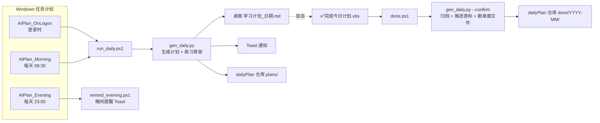

# Daily Plan Agent · 每日学习计划自动推送与确认归档系统

> **AI 实践项目** —— 本项目由 AI 智能体（TRAE + GLM 模型）全程落地编码，人负责定义学习规则、确认验收与实际执行。整个开发过程（约 3 小时）是一次完整的人机协作实践：需求口述 → 架构协商 → AI 编码 → 真实环境端到端测试 → 迭代修复。

一个跑在 Windows 上的零依赖"学习计划管家"：**每天自动生成学习计划 → 桌面弹通知 → 完成后一键归档到 GitHub**。纯 Python 标准库 + PowerShell 原生能力，不装任何第三方包。

## 痛点

学习计划写得再好，也逃不过三个结局：

1. 计划文件躺在网盘里，三天后再也没打开过；
2. "学了"和"没学"没有硬性分界，拖延不需要付出任何成本；
3. 学了容易忘，没有强制回顾机制。

本系统的解法：**计划主动找你**（定时 Toast 通知 + 桌面文件 + GitHub 推送），**不确认就不前进**（题号游标只在确认后推进），**每天一道手写题防遗忘**（周日重写日强制回顾）。

## 系统架构



## 核心机制：确认游标

系统是一个小的状态机，`state.json` 记录全部状态：

- **生成不改状态**：同一天重复运行（登录 + 8:30 两次触发）不重复出题；
- **确认才推进**：只有 `--confirm` 结算时，题号 `q_index` 才 +1、`streak` 连续打卡才结算；
- **未确认则卡关**：有遗留未确认计划时，次日不推进新题，继续攻克同一题，并在计划头部给出醒目警告；
- **多日遗留一次归档**：确认时遍历全部 `pending` 计划一并移入 `done/YYYY-MM/`；
- **周日复习题**：标记 `review` 的题目确认后不推进题号（复习日不算新题）。

## 仓库布局（dailyPlan，建议建成私有仓库）

```
dailyPlan/
├── plans/          # 进行中的计划（生成时写入，推送 GitHub）
├── done/2026-10/   # 确认后归档（一键归档，自动推送）
└── practice/       # 每日手写练习 .py 骨架（跑通输出 AC!）
```

## 快速开始

```powershell
# 1. 克隆本仓库，在旁边建好 dailyPlan 仓库（git init + GitHub 私有仓库）
#    目录结构：
#    <父目录>/
#    ├── daily-plan-agent/   ← 本项目
#    └── dailyPlan/          ← 归档仓库

# 2. 按需修改 run_daily.ps1 / done.ps1 顶部的 python.exe 路径
#    （找不到时自动回退到 py 启动器）

# 3. 安装计划任务（普通用户权限，无需管理员）
powershell -ExecutionPolicy Bypass -File install_task.ps1

# 4. 建桌面确认入口：新建 ✅完成今日计划.vbs
```

```vbs
CreateObject("Wscript.Shell").Run "powershell.exe -ExecutionPolicy Bypass -WindowStyle Hidden -File ""<脚本目录>\done.ps1""", 0, False
```

卸载：`schtasks /Delete /TN AIPlan_OnLogon /F`（另有 AIPlan_Morning、AIPlan_Evening）。

## 文件说明

| 文件 | 作用 |
|---|---|
| `gen_daily.py` | 计划生成器（纯标准库）。内置技能站时间表 `STAGES` 与 LeetCode 题库 `Q`，生成计划 md + 手写练习骨架 + `state.json` 状态机；`--confirm` 进入归档结算 |
| `run_daily.ps1` | 登录/08:30 触发：生成 → Toast 通知 → 推送 dailyPlan 仓库（失败只记日志，下次自动补推） |
| `done.ps1` | 桌面确认入口调用：`--confirm` 结算 → git 归档推送 → Toast 反馈（含连续打卡天数） |
| `remind_evening.ps1` | 23:00 晚间提醒：完成了吗？完成→确认归档，未完成→文件保留明天继续 |
| `install_task.ps1` | 一键注册 3 个计划任务（登录 / 08:30 / 23:00） |

## 学习计划本身

`gen_daily.py` 里的 `STAGES` 是为 AI Engineer 方向定制的串行深耕时间表（S1 Python/NumPy → S2 PyTorch → … 每站以"可运行的实际产出"为毕业标准），`Q` 是配套的 LeetCode 手写题库。fork 后直接改成你自己的计划即可——**规则即代码**。

## 踩坑记录

开发过程中的真实坑，供复现者参考：

- **`schtasks /Change /TR` 会触发密码提示**并可能导致任务损坏 —— 修改任务时用删除 + 重建；
- **PowerShell 5.1 的 `Set-Content -Encoding UTF8` 写 BOM** —— 含中文的 .ps1 必须 UTF-8 BOM，但 JSON 状态文件带 BOM 会让 `json.load` 报错，读取侧用 `encoding="utf-8-sig"` 兜底；
- **WinRT Toast 在计划任务里调用**需要 `ContentType=WindowsRuntime` 装配加载，且要用 `CreateToastNotifier` 指定应用 Id；
- **幂等设计**：触发源有登录 + 定时两个，生成逻辑必须幂等，否则一天出两份题。

## 与作者实际部署的关系

本仓库是**通用化版本**（路径自适应、Python 路径可配置）。作者本机实际部署在 learning-notes 仓库的 daily/ 目录，配套归档仓库为私有 dailyPlan。运行效果可在 dailyPlan 仓库的 `plans/`、`done/` 目录中查看真实生成的计划。

---

*编码：TRAE 智能体（GLM 模型）｜需求与验收：GEISTD｜2026-10*
